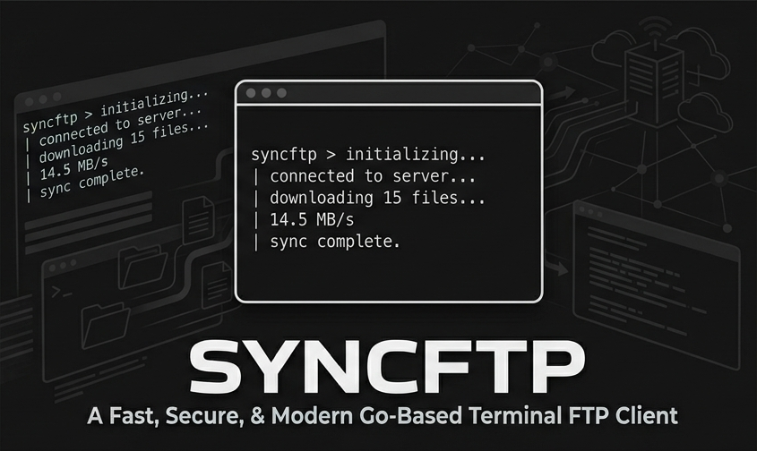

# syncFTP



**syncFTP** deploys the files you changed — detected by SHA256, not timestamps — from a local project to one or more **FTP, FTPS or SFTP** servers. Use it from a **desktop panel**, an **interactive terminal shell**, or plain **CLI commands**; wire it to **git push** for CI/CD; undo any deploy with **rollback**.

```
local project ──▶ change detection (SHA256 + cache) ──▶ filters ──▶ backup ──▶ atomic upload ──▶ FTP / FTPS / SFTP
                                                                        │
                                       rollback ◀── .syncftp/releases ──┘
```

---

## Highlights

**Deploy**
- **Hash-based change detection** — works in any folder, no git required; only changed files are uploaded
- **FTP, FTPS (TLS) and SFTP (SSH)** — password or SSH key; optional **SSH tunnel** through a jump host
- **Multi-server, in parallel** — production and staging in one go; connection profiles share credentials
- **First sync without re-uploading** — *calibrate* matches what is already on the server by size

**Safety**
- **Rollback** — every sync backs up the server version of the files it replaces; undo any release, and see a per-file diff of what each release changed
- **Atomic uploads** — temp file + rename, so a dropped connection never leaves a half file live
- **Resume** — interrupted syncs continue where they stopped
- **Protect / freeze / ignore** — never overwrite `.env`, skip files or whole folders per server, never even scan `vendor/`
- **Drift detection** — `verify` finds files changed or deleted on the server by hand

**Automation**
- **Watch** — upload on save (OS file events, zero CPU while idle)
- **CI/CD** — GitHub / GitLab / Gitea / Bitbucket push → signed webhook → `git pull` → deploy, with a one-click public URL (Cloudflare *trycloudflare*)
- **Hooks** — local `pre_sync` / `post_sync`, and **remote SSH commands** on SFTP servers (`php artisan migrate` …)
- **Webhooks out** — Slack / Discord / any URL after each sync

**Interfaces**
- **Desktop panel** with **system tray**, live job logs (stoppable), remote file browser with diff and an **in-place editor** for server files, help page and an **AI assistant** (Claude Code / OpenCode)
- **Interactive shell** with an arrow-key file browser, TUIs for status / sync / config
- **CLI** for scripts, plus a **local HTTP API** (`syncftp serve`)

**Security & performance**
- Passwords in the **OS keyring** (Windows Credential Manager / Keychain / Secret Service)
- Unchanged files are never re-hashed, hashing is parallel, connection limit is **measured** and shared, optional **bandwidth limit**

The interface follows your OS language (Turkish or English); switch with `syncftp lang tr|en` or the panel's language toggle.

---

## Contents

- [Installation](#installation) · [Quick start](#quick-start) · [Three ways to use it](#three-ways-to-use-it)
- [Desktop panel](#desktop-panel) · [Configuration](#configuration) · [Protocols & SSH tunnel](#protocols--ssh-tunnel)
- [How a sync works](#how-a-sync-works) · [Filters](#filters) · [Backup, rollback & atomic uploads](#backup-rollback--atomic-uploads)
- [Automation](#automation-watch-hooks-webhooks) · [CI/CD](#cicd--deploy-on-git-push) · [Performance](#performance)
- [Security](#security) · [Multiple projects](#multiple-projects) · [Command reference](#command-reference)
- [Files on disk](#files-on-disk) · [Development](#development)

---

## Installation

Requires **Go 1.26+** → https://go.dev/dl/

```bash
git clone https://github.com/mustafaomereser/syncftp
cd syncftp
go build -o syncftp.exe ./cmd/syncftp/   # Windows (icon embedded via rsrc.syso)
go build -o syncftp     ./cmd/syncftp/   # Linux / macOS
```

It is a single self-contained binary — the desktop panel's web UI is embedded. Put it anywhere (optionally on `PATH`).

> The system tray is Windows-only. On Linux/macOS the panel works in the browser and exits when its window closes; use `syncftp hook serve` for a long-running CI/CD listener.

---

## Quick start

**With the desktop panel**

1. Double-click `syncftp.exe` → the panel opens and a tray icon appears.
2. **Add project** (`+` in the sidebar) → pick your project folder; a config is created if needed.
3. **Servers → Add server** → protocol, host, user, password or SSH key, remote path → *Test connection* → *Save*.
4. **Overview → Sync.** The first sync calibrates against what is already on the server, then uploads only differences.

**From a terminal**

```bash
cd /path/to/your/project
syncftp init      # wizard → .syncftp/syncftp.json (+ ignore template)
syncftp status    # what changed (nothing is uploaded)
syncftp sync      # upload changed files
```

Already deployed by hand? The first `status`/`sync` runs **calibrate** automatically, so you will not see hundreds of false "new" files.

---

## Three ways to use it

| | Start | Best for |
|---|---|---|
| **Desktop panel** | double-click the exe, or `syncftp gui` | everyday use, many projects, watch & CI/CD in the tray |
| **Interactive shell** | `syncftp` in a terminal (no arguments) | keyboard-driven work, browsing the server |
| **CLI** | `syncftp <command> [flags]` | scripts, servers, CI runners |

All three share the same config, state, backups and logs.

---

## Desktop panel

```bash
syncftp gui                       # open the panel (terminal is released)
syncftp gui --foreground          # run the panel in this process
syncftp gui --foreground --no-window   # don't open a window, print the login URL (SSH port forwarding)
syncftp gui --foreground --background  # tray only (used by "Start with Windows")
```

The panel is a local web app served on `127.0.0.1` with a per-session token, shown in an Edge/Chrome app window. Like the CLI it works on the folder it was started in: it shows the syncFTP project in that folder and in its subfolders (two levels). One panel runs per folder — launching again from the same folder brings its window to front; *Quit* also closes the window.

**Tabs per project**

| Tab | What you can do |
|---|---|
| **Overview** | pending changes per server (`+new ~changed −deleted`; click for the list and a coloured local ↔ server diff), sync / dry-run / full sync / retry failed, calibrate, verify (+fix), measure connection limit, compare two servers, milestone, freeze list, watch on/off, run a command on the server (SFTP) |
| **Servers** | add / edit / duplicate / enable / delete servers; protocol, SSH key, tunnel, paths, performance, filters, hooks, remote SSH commands; *Test connection* without saving. A server that uses a connection profile shows a short summary of the profile (with *Edit profile*) instead of its credential fields; a server with hand-entered details can be turned into a profile with *Make it a profile* |
| **Connections** | shared credential profiles; *From a server* moves a server's details into a profile (an existing profile for the same account is reused), *From library* / *Save to library* — entries already in the library show an *In library* badge, and saving over a same-named library entry for another account asks first |
| **Files** | remote browser: preview with syntax highlighting (HTML files also rendered in a sandboxed frame), compare with local, **edit**, download, upload, new folder, rename / move (with a remote folder picker), multi-select, freeze toggle (files or whole folders), recursive search with live results, tree view. Badges show files that sync will never upload: *frozen*, *ignore*, *exclude*, *not included* (the filters apply to the local side; the server copy is left alone) |
| **History** | releases with backup state; open a release to see its changed files as a **folder tree** next to the **diff** of the selected file (previous server version → uploaded version), tick files and **roll back only those**, or roll back the whole release; sync logs |
| **CI/CD** | deploy triggers, webhook listener, trycloudflare tunnel, recent deliveries |
| **Settings** | global sync settings, ignore rules editor with templates (per local folder), OS keyring, config import / export, local HTTP API, and a **Danger zone** to remove the project from syncFTP |

The sidebar also has app-wide **Settings** (start with Windows, editor save target, webhook port, connection library, new-project defaults, known SSH hosts, hash cache, and **data locations** — every file and folder syncFTP writes, with copy / open buttons) and a **Terminal** that runs the syncFTP shell inside the panel.

**Editing server files** — *Edit* in a file's preview (or the code icon on its row) loads the whole file (up to 4 MB; binary and non-UTF-8 files are view-only) into an editor with syntax highlighting, Tab / Shift+Tab indenting and `Ctrl+S`. Saving goes through the normal upload core, so the old server version is backed up and the save can be undone from *History*. Choose per save — or remember the choice — between **server + local** (the local file is written too, keeping its CRLF line endings, and the state is updated) and **server only** (the state is left alone, so the next sync does not overwrite your edit unless the local file changes). If someone changed the file on the server since you opened it, you are asked to overwrite or reload. In the preview window `S` edits, `R` compares with the local file and `D` downloads; `Esc` in the editor or compare view returns to the preview.

**Jobs** — every job's log window has a **Stop** button while the job can be cancelled (calibrate, watch); stopping a calibrate cuts the connection immediately, even while the server is not answering, and leaves the state untouched. Forms (server, connection, project settings) ask before you leave them with unsaved changes.

Folder and file pickers run **inside the panel** (no native dialogs); include / exclude / protect / freeze lists can be ticked in a file tree. Every operation runs as a background job with a live log in the bottom-right corner. A **Help** page (sidebar, and the `?` button on every tab) contains task guides and a CLI reference generated from the program itself.

**System tray (Windows)** — left click opens the panel; right click opens a dark menu with status, *Open panel*, *Projects* (opens the panel on that project), *Jobs*, active watches (click to stop), webhook tunnel on/off and *Quit*. Closing the window keeps syncFTP running in the tray; watches that were running are restored on the next start. A green dot on the icon means a job or watch is running.

### AI assistant (panel only)

Click **AI assistant** in the sidebar. The panel lists the supported AI coding tools installed on your machine:

- **Claude Code** and **OpenCode** run as an **in-panel chat** — ask questions or say "add an SFTP server for …", "deploy on push to main", "protect .env and skip vendor"; it edits the config and runs `syncftp` commands for you.

For each session syncFTP writes `.syncftp/ai/` — `README.md` (rules), `CLI.md` (command reference), `CONFIG.md` (schema) and `PROJECT.md` (a secret-free snapshot of the project) — and the assistant reads them. It may only edit project files and run `syncftp` commands; it is told never to reveal passwords and to ask before real syncs, rollbacks, deletions or remote commands.

---

## Configuration

`.syncftp/syncftp.json` in your project (permission `600`; `.syncftp/` is added to `.gitignore`). Edit it in the panel, with `syncftp config` (TUI) or by hand.

```json
{
  "project": { "name": "shop", "default_path": ".", "keyring": false },
  "sync": {
    "protect": [".env", "storage/"],
    "include": [],
    "exclude": ["docs"],
    "ignore_files": null,
    "block_extensions": [".psd", ".zip"],
    "webhook": "https://hooks.slack.com/services/…",
    "pre_sync": ["npm run build"],
    "post_sync": [],
    "bandwidth_limit": 0,
    "backup_keep": 10
  },
  "first_sync": { "full": false },
  "connections": [
    { "name": "vps", "protocol": "sftp", "host": "example.com", "port": 22, "user": "deploy",
      "key_file": "~/.ssh/id_ed25519" }
  ],
  "servers": [
    { "name": "production", "connection": "vps", "remote_path": "/var/www/shop",
      "enabled": true, "max_connections": 6, "max_retries": 2,
      "remote_post_sync": ["php artisan migrate --force"] },
    { "name": "staging", "protocol": "ftp", "host": "ftp.host.com", "user": "u", "password": "…",
      "remote_path": "/staging", "local_path": "dist", "enabled": true, "max_connections": 3 }
  ],
  "deploy": [
    { "name": "main", "provider": "github", "secret": "…", "branch": "main",
      "servers": ["production"], "git_pull": true, "enabled": true }
  ]
}
```

### Field reference

**Project & global sync**

| Field | Default | Description |
|---|---|---|
| `project.name` | — | Display name |
| `project.default_path` | `"."` | Local folder to scan, relative to the project root (servers may override with `local_path`) |
| `project.keyring` | `false` | Passwords stored in the OS keyring; JSON keeps a `"keyring:"` marker (`syncftp secure`) |
| `sync.protect` | `[]` | Never overwrite these on any server (`dir/` for folders) |
| `sync.include` | `[]` | Whitelist — sync only these paths (empty = all) |
| `sync.exclude` | `[]` | Skip these paths — see [pattern rules](#pattern-rules) |
| `sync.ignore_files` | `null` | Which ignore files to load — `null`/empty = `.gitignore` + `.syncftp/syncftp.ignore` |
| `sync.block_extensions` | `[]` | Never upload these extensions; per-server list is added on top |
| `sync.webhook` | `""` | POST after each sync (Slack / Discord URLs are formatted automatically) |
| `sync.pre_sync` / `sync.post_sync` | `[]` | Local shell commands before / after upload |
| `sync.bandwidth_limit` | `0` | KB/s per server (shared by its connections); `0` = unlimited |
| `sync.no_backup` | `false` | Disable backups → no rollback |
| `sync.backup_keep` | `10` | Releases that keep their backup files |
| `sync.direct_upload` | `false` | Disable atomic temp + rename upload |
| `first_sync.full` | `false` | `true` = upload everything on the first sync instead of calibrating |

**Servers** (`servers[]`) — connection fields can come from a profile (`connections[]`, same field names)

| Field | Default | Description |
|---|---|---|
| `name` | — | Unique server name |
| `connection` | `""` | Use a connection profile (host, port, user, password, protocol, key, TLS and tunnel come from it) |
| `protocol` | `"ftp"` | `ftp`, `ftps` (explicit TLS) or `sftp` |
| `host` / `port` / `user` / `password` | — / 21 or 22 | Credentials; port defaults by protocol |
| `key_file` | `""` | SFTP private key; if encrypted, `password` is used as passphrase |
| `tls_skip_verify` | `false` | FTPS: skip certificate verification |
| `passive` / `disable_epsv` / `nat_workaround` | `true` / `false` / `false` | FTP connection tweaks (NAT: ignore the PASV IP, use the host) |
| `tunnel_host` / `tunnel_port` / `tunnel_user` / `tunnel_password` / `tunnel_key_file` | — | SSH jump host; empty `tunnel_host` = none; `tunnel_user` defaults to `user` |
| `remote_path` | — | Target folder on the server |
| `local_path` | `""` | Local folder for this server (relative to the project); empty = `project.default_path` |
| `enabled` | `true` | Disabled servers are skipped by "sync all" |
| `max_connections` | `1` | Parallel connections (`syncftp detect-limit` measures the server's maximum) |
| `max_retries` | `2` | Retries per file |
| `include` / `exclude` / `protect` / `block_extensions` | `[]` | Per-server filters (include overrides global; the others add to it) |
| `pre_sync` / `post_sync` | `[]` | Local commands, run after the global ones |
| `remote_pre_sync` / `remote_post_sync` | `[]` | **SFTP only** — commands run **on the server** over SSH in `remote_path` |
| `webhook` | `""` | Overrides `sync.webhook` |
| `minify` / `obfuscate` | `false` | Minify CSS/JS (built in) / obfuscate JS with `terser` (`npm i -g terser`) |
| `bandwidth_limit` / `no_backup` / `direct_upload` | — | Per-server versions of the sync settings |

**CI/CD triggers** (`deploy[]`) — see [CI/CD](#cicd--deploy-on-git-push)

| Field | Description |
|---|---|
| `name` | Used in the URL `/hook/<project>/<name>` |
| `provider` | `github`, `gitlab`, `gitea`, `bitbucket`, `generic` |
| `secret` | Signature / token secret |
| `branch` | Only this branch (empty = any) |
| `servers` | Targets (empty = all enabled) |
| `git_pull` | Run `git pull --ff-only` in the project before syncing |
| `dry_run` / `enabled` | Log only / switch on-off |

---

## Protocols & SSH tunnel

| Protocol | Use when | Notes |
|---|---|---|
| `ftp` | classic shared hosting | Text files are uploaded with LF line endings (avoids blank-line issues on PHP hosts); binaries byte-for-byte |
| `ftps` | hosting that offers FTP over TLS | Explicit TLS ≥ 1.2; `tls_skip_verify` if the certificate does not match the host name |
| `sftp` | VPS / any server with SSH | Byte-exact; password or SSH key; enables **remote SSH commands** |

**Host keys** are checked against `~/.ssh/known_hosts` and syncFTP's own `known_hosts`. Unknown hosts are trusted on first use and recorded; a changed key is refused.

**SSH tunnel** — when the server is not reachable directly, the connection goes through a jump host. For FTP both control and passive data connections are tunnelled; for SFTP the SSH session itself is.

```json
{ "name": "internal", "protocol": "sftp", "host": "10.0.0.12", "user": "app", "password": "…",
  "tunnel_host": "bastion.example.com", "tunnel_user": "jump", "tunnel_key_file": "~/.ssh/id_ed25519",
  "remote_path": "/srv/app" }
```

Every network read/write has an idle timeout and SSH connections send keepalives, so a stalled connection fails cleanly instead of hanging a sync or watch.

---

## How a sync works

1. **Scan** the server's local folder: ignored folders are not entered; files with unchanged size + mtime reuse their cached SHA256; the rest are hashed in parallel.
2. **Diff** against the server's state (`.syncftp/state/<server>.json`) → new / changed / deleted. On the very first run, **calibrate** first matches files already on the server by size (CRLF-aware).
3. **Filter**: include → exclude → milestone → freeze → blocked extensions → protect.
4. **pre_sync** hooks (local, then remote SSH). A failure aborts that server.
5. **Upload** through a connection pool: back up the server version → upload to a temp name → rename into place. State is checkpointed every 20 files.
6. Write the **release manifest**, send the **webhook**, run **post_sync** hooks (remote SSH, then local).

Files deleted locally are **reported, never deleted** from the server. Every sync that uploads something writes a plain-text log to `.syncftp/logs/<server>/`.

---

## Filters

| Mechanism | Scope | Effect | Managed via |
|---|---|---|---|
| **Ignore** (`.gitignore` + `.syncftp/syncftp.ignore`) | project | never scanned; ignored folders are not walked locally or remotely | file / panel *Settings → Ignore rules* (templates: Laravel, WordPress, Node.js, generic) |
| **Include** | global or per server | only these paths | config / panel tree picker / `--include` |
| **Exclude** | global + server + CLI | skip these paths | config / panel tree picker / `--exclude` |
| **Protect** | global + server | never overwrite on the server | config / panel tree picker |
| **Freeze** | per server | skip even when changed; a frozen folder is one `folder/` entry that covers everything inside it, including files added later | `syncftp freeze`, `f` in the shell browser, ❄ in the panel |
| **Blocked extensions** | global + server | never upload these extensions | config |
| **Milestone** | per server | only files modified after a date | `syncftp milestone` |

Include priority: CLI `--include` → server `include` → global `sync.include`. Exclude and protect lists are combined.

Exact file paths that no longer exist locally are removed from **include / exclude** automatically before a sync (globs and folders are kept). For safety the cleanup never touches **protect** lists, never empties an include list (an empty include would mean "everything"), removes a global entry only when the path is missing for every server, and skips dry-runs.

### Pattern rules

Include, exclude and protect use the same matcher everywhere (sync, status, calibrate, verify, the panel):

| Pattern | Matches |
|---|---|
| `app` or `app/` | the folder `app` and everything in it (a trailing `/` marks a folder); a leading `/` is ignored |
| `config/app.php` | exactly that file |
| `*.log` | any `.log` file at any depth (no `/` in the pattern → matched against every file and folder name) |
| `src/*.min.js` | `.min.js` files directly in `src` (a `/` in the pattern → matched against the whole path) |
| `build*/` | every folder starting with `build` and its contents |

The status views (CLI, shell, panel) list frozen, protected and blocked files separately, so the pending count is exactly what `sync` will upload.

---

## Backup, rollback & atomic uploads

Right before a file is uploaded, its current server version is downloaded into the release folder (`.syncftp/releases/<server>/<id>/files/`); files that did not exist on the server are recorded as *new*.

```bash
syncftp rollback --list -s production            # history
syncftp rollback -s production                   # pick a release
syncftp rollback 20261016-063017 -s production -y
```

Rolling back a release also rolls back every newer one (newest first): replaced files get their previous version back (byte for byte), new files are deleted, and the state returns to the old hashes so the next `sync` detects your local changes again. If a release can only be partly rolled back, older releases are left untouched. Only the last `sync.backup_keep` releases keep backup files.

**Rolling back selected files** returns just those files to their version before the release (files the release added are deleted). Newer releases that changed the same files are rolled back for those files too; the releases are marked *partly rolled back*, and a later full rollback does not touch those files again:

```bash
syncftp rollback 20261016-063017 -s production --files css/app.css,js/app.js
```

In the panel: *History → Details* → tick files (or whole folders) in the tree → *Roll back selected*.

Each release also keeps a copy of the **uploaded** version of every file up to 2 MB (`after/`), so you can see exactly what a deploy changed:

```bash
syncftp rollback 20261016-063017 -s production --diff               # every file of the release
syncftp rollback 20261016-063017 -s production --diff=css/app.css   # one file
```

The panel shows the same diff under *History → release → file*. For releases made before this existed, the local file is used when it still has the uploaded hash. Release lists and counters are read from a small per-server index (`releases/<server>/index.json`), so projects with thousands of releases open instantly.

Uploads are **atomic** (`.syncftp-<name>.tmp` → rename); if the server refuses rename-over, syncFTP falls back to a direct write. `direct_upload: true` skips the temp file. Interrupted syncs **resume**: state is saved every 20 uploaded files.

---

## Automation: watch, hooks, webhooks

**Watch** — `syncftp watch [--server NAME | --all]` or *Start watch* in the panel. OS file events, 800 ms debounce, ignored folders are not watched, editor temp files are skipped; events during a sync trigger one more run afterwards.

**Local hooks** — `pre_sync` / `post_sync` run through the system shell (`cmd /C` / `sh -c`) in the project folder, global first then per server. Environment: `SYNCFTP_SERVER`, `SYNCFTP_UPLOADED`, `SYNCFTP_FAILED`. A failing `pre_sync` aborts that server; `post_sync` failures are reported only.

**Remote SSH commands** (SFTP servers)

```json
"remote_pre_sync":  ["php artisan down"],
"remote_post_sync": ["composer install --no-dev", "php artisan migrate --force", "php artisan up"]
```

Run on the server in `remote_path` with the same environment variables. One-off: `syncftp remote exec -s production "php artisan cache:clear"`, `exec <cmd>` in the shell, or *Run command on server* in the panel.

**Outgoing webhook** — POSTed after each sync. Slack and Discord webhook URLs get a readable message; other URLs receive JSON:

```json
{ "server": "production", "uploaded": 5, "failed": 0, "files": ["index.php", "css/app.css"] }
```

Use *Test* next to the webhook field in the panel to send a sample.

---

## CI/CD — deploy on git push

```
git push ─▶ https://<public>/hook/<project>/<trigger> ─▶ signature check ─▶ branch filter ─▶ [git pull] ─▶ sync (backup + rollback)
```

1. Panel → project → **CI/CD** → **Add trigger** (provider, branch, servers, *git pull first*).
2. **Start tunnel** — syncFTP starts a Cloudflare *trycloudflare* quick tunnel and shows a public https URL (the panel can download the official `cloudflared` if it is missing). For a permanent address enter your own domain (Cloudflare named tunnel, reverse proxy) instead — the trycloudflare URL changes on every start.
3. Click **Setup** for provider-specific steps and paste the URL and secret into your repository's webhook settings.

| Provider | Verification |
|---|---|
| GitHub, Bitbucket | `X-Hub-Signature-256` HMAC-SHA256 |
| Gitea | `X-Gitea-Signature` |
| GitLab | `X-Gitlab-Token` |
| Generic (any CI) | `X-Syncftp-Token` header, `?token=` or `Authorization: Bearer` |

The webhook listener (`127.0.0.1:47821`) is separate from the panel; the panel itself is never exposed. Pushes arriving during a deploy are coalesced into one more run, and each server's sync waits for any job already running on that server. *Deploy now* runs a trigger by hand.

Without the panel (e.g. on a server):

```bash
syncftp hook serve --tunnel                 # listener + trycloudflare URL
syncftp hook serve --addr 0.0.0.0:47821     # expose directly behind your own proxy
syncftp hook list                           # triggers in all projects
```

---

## Performance

- **Change detection** — unchanged files (same size + mtime) are not re-read; hashing runs on up to 8 cores; ignored folders are skipped on both sides (a `vendor/` pattern no longer makes syncFTP walk `vendor/` file by file).
- **Connection limit** — `syncftp detect-limit -s NAME` opens connections until the server refuses and saves the number. Servers that use the same account share one limit; the first connection retries on `421 Too many connections`.
- **Bandwidth** — `bandwidth_limit` (KB/s) caps the total upload speed of a server.
- **Parallel servers** — multi-server syncs run concurrently, each with its own pool.

---

## Security

- **OS keyring** — `syncftp secure` (or *Settings → Security*) moves all passwords (servers, profiles, tunnels) into Windows Credential Manager / macOS Keychain / Linux Secret Service. Entries are per account (`protocol://user@host:port`), so renaming a server keeps working. `syncftp secure --off` writes them back.
- **Host key verification** for SFTP / SSH tunnels (trust on first use, mismatch refused).
- **Panel** — listens on `127.0.0.1` only, requires a per-session token, checks the `Host` header, and never sends stored passwords to the page.
- **Local HTTP API** (`serve`) — `Host` / `Origin` checks, local-only CORS, optional token, remote paths confined to `remote_path`.
- **State files** — config, state, freeze, failed and milestone files are written atomically (temp file + rename), and syncs, edits and calibrations of the same server never run at the same time, even across watch, panel jobs, CI/CD and the HTTP API.
- **Exports** — `syncftp config --export` prints the config with every password masked.
- `.syncftp/` is ignored by git and never uploaded.

---

## Multiple projects

Every folder with a `.syncftp/syncftp.json` is registered machine-wide when you use it (and by `init`). The panel lists them; the CLI can target any of them from anywhere:

```bash
syncftp project list
syncftp project add D:\sites\blog --name blog
syncftp project rename blog blog-prod
syncftp project rm blog-prod            # removes it from the list only
syncftp project delete blog-prod        # remove the project from syncFTP (see below)

syncftp -P shop sync --all
syncftp --project D:\sites\blog status
```

**Removing a project** — `syncftp project delete [NAME|PATH] [-y]` or *Project settings → Danger zone* in the panel moves the project's `.syncftp/` folder (config, state, release backups, logs) to the **trash** (Recycle Bin on Windows, `~/.Trash` on macOS, `gio trash` on Linux); if no trash is available it is renamed to `.syncftp.removed-<time>`. Restore it to bring the project back. Project files and servers are not touched, and keyring passwords are kept because the library and other projects may share them. It is refused while a job is running or another process watches the project; the panel stops the project's watches, terminal and HTTP API first.

---

## Command reference

Run `syncftp <command> --help` for every flag. The panel's **Help** page shows the same reference.

| Command | Purpose |
|---|---|
| `syncftp` | interactive shell |
| `syncftp gui` | desktop panel |
| `init` | setup wizard |
| `status` | pending changes (TUI without flags) |
| `sync` | upload changes |
| `calibrate` | match existing server files, initialise state |
| `verify` | find drift on the server |
| `rollback` | undo releases or selected files (`--files`), `--diff` to see what a release changed |
| `milestone` | time-based filter / sync |
| `freeze` | per-server freeze list |
| `watch` | upload on save |
| `diff` | compare two servers |
| `detect-limit` | measure the connection limit |
| `remote ls / cat / get / rm / exec` | work on the server |
| `logs [FILE\|last]` | list / show sync, rollback and calibrate logs |
| `push` | one-off sync of any folder without a config |
| `config` | server / profile editor (TUI), `--export`, `extract-conn` |
| `hook serve / list` | CI/CD webhook listener |
| `project list / add / rm / rename / delete` | project registry, remove a project from syncFTP |
| `secure` | OS keyring on / off |
| `lang` | language |
| `serve` | local HTTP API |

### `init`

Asks for the project name, local folder and the first server, writes `.syncftp/syncftp.json`, adds `.syncftp/` and the binary to `.gitignore`, registers the project and offers an ignore template (Laravel, WordPress, Node.js, generic). An existing `syncftp.ignore` is never overwritten.

### `status`

```bash
syncftp status [--server NAME] [--include PATH] [--exclude PATH]
```

Shows new / changed / deleted files per server; frozen files are listed separately and an active milestone is noted. Without flags it opens a TUI where you can browse servers and start a sync.

### `sync`

```bash
syncftp sync                       # server picker if several are enabled
syncftp sync --all                 # all enabled servers
syncftp sync --server production
syncftp sync --dry-run             # show what would be uploaded
syncftp sync --full                # ignore state, upload everything
syncftp sync --retry-failed        # only files that failed last time
syncftp sync --include css --exclude vendor
```

```
══ production (ftp.example.com) ══
  ❄ 2 frozen (skipped)
  3 files to process
  Connection pool: 3 / Retry: 2
    ✓ js/utils.js
    ✓ css/dark-mode.css
    ✓ index.php
  ↺ Backup: 2 previous version(s) saved, 1 new file(s) — undo with: syncftp rollback --server production
  Done: 3 uploaded, 0 protected, 0 errors
  ↑ 1.2 MB · 4s
```

Errors such as a refused connection are printed in the server's output, and `sync` exits with code 1 when any server fails, so scripts and CI runners can detect it.

### `calibrate`

```bash
syncftp calibrate [--server NAME | --all]
```

Compares local files with the server's file sizes (CRLF-aware) and records matching files as up to date — nothing is uploaded. Runs automatically on the first `status`/`sync`; run it by hand after deploying with another tool or losing the state. If the automatic calibrate fails (for example the server is unreachable), that server's sync is aborted instead of uploading every file. Frozen folders are not listed on the server, which keeps calibrate fast next to huge folders such as `node_modules/` or `uploads/`.

In the terminal, press `→` while listing to stream scanned paths, `←` to hide, `ctrl+c` to cancel. In the panel the job log shows each phase live (local scan, connecting, files listed with the latest path, comparing) and **Stop** cancels it. A log with every remote file is saved.

### `verify`

```bash
syncftp verify -s production [--fix]
```

Checks that every file the state considers up to date exists on the server with the expected size. Missing or changed files are drift; `--fix` drops them from the state so the next sync re-uploads them.

### `rollback`

```bash
syncftp rollback [RELEASE-ID] [-s NAME] [--list] [-y]
syncftp rollback RELEASE-ID [-s NAME] --diff[=PATH]     # show what the release changed, no rollback
syncftp rollback RELEASE-ID [-s NAME] --files A,B        # roll back only these files
```

See [Backup, rollback & atomic uploads](#backup-rollback--atomic-uploads).

### `milestone`

```bash
syncftp milestone set [--date "3d"] [-s NAME]
syncftp milestone [show]
syncftp milestone sync [--dry-run]
syncftp milestone clear
```

While a milestone exists, `status`/`sync`/watch/API only consider files modified after it; `milestone sync` force-uploads everything modified after it. Dates (local time, Turkish and English keywords): `now`/`şimdi`, `today`/`bugün`, `yesterday`/`dün`, `30m`, `5h`, `3d`, `2w`, `14:30`, `20.07`, `20.07.2026 14:30`, `2026-07-20 15:04`.

### `freeze`

```bash
syncftp freeze [--server NAME]
```

Full-screen list of local files: type to filter, `Space` toggles, `a` toggles all, `Enter` saves. Frozen folders are listed first as `folder/` entries and the files inside them are hidden. Also available with `f` in the shell file browser and as ❄ in the panel.

Freezing a folder stores a single `folder/` entry — nothing is listed on the server, so it is instant even for folders with tens of thousands of files — and everything inside it, including files added later, is frozen. A file inside a frozen folder cannot be unfrozen on its own (unfreeze the folder). Older lists with one entry per file keep working; unfreezing and re-freezing the folder collapses them into one entry.

### `watch`

```bash
syncftp watch [--server NAME | --all]
```

### `diff`

```bash
syncftp diff production staging     # or no arguments for pickers
```

Lists files only on one server and files whose size differs.

### `detect-limit`

```bash
syncftp detect-limit -s production [--max 32] [--no-save]
```

### `remote`

```bash
syncftp remote ls [PATH] [--server NAME]        # interactive browser
syncftp remote cat [FILE] [--max-kb 50]
syncftp remote get [FILE] [DEST]
syncftp remote rm [FILE] [--recursive] [--force]
syncftp remote exec -s NAME "COMMAND"           # SFTP: run over SSH in remote_path
```

### `push`

Syncs any folder without a project config (state is kept in `<folder>/.syncftp/`).

```bash
syncftp push ./site --host ftp.example.com --user admin --pass secret --remote /public_html [--connections 3] [--dry-run] [--full]
syncftp push ./site --server production          # reuse a configured server
```

Flags: `--host`, `--port` (21), `--user`, `--pass`, `--remote` (`/`), `--passive`, `--server`, `--full`, `--dry-run`, `--include`, `--exclude`, `--connections` (1), `--retries` (2).

### `config`

```bash
syncftp config                          # TUI
syncftp config --export                 # JSON with passwords masked
syncftp config extract-conn production [--name shared-host]   # move a server's credentials into a connection profile
```

`extract-conn` creates a connection profile from a server's hand-entered details and links the server to it; if a profile for the same account already exists, the server is linked to that one instead.

The TUI has a server list (`Enter` edit, `Space` enable/disable, `d` delete, `n` new), **Global settings**, **Connection profiles** and a field editor for every server option. Fields that come from a connection profile are shown read-only. `b` opens pickers: profile, local folder, or a local file browser for include / exclude / protect (`Space` mark, `n` custom path such as a glob, `s` save).

### Interactive shell

Run `syncftp` without arguments.

| Command | Description |
|---|---|
| `servers` / `server [NAME]` / `disconnect` | list, connect, disconnect |
| `ls [PATH]` | arrow-key file browser |
| `tree [PATH] [--max N]` | remote tree |
| `cd` / `pwd` / `cat` / `get` / `rm [-f] [-r]` | remote file commands |
| `status` / `sync [--all] [--full] [--dry-run] [--server N]` | changes / upload |
| `watch` / `calibrate` / `verify [--fix]` / `detect-limit` | as the CLI commands |
| `rollback [ID] [--list]` | undo releases on the connected server |
| `milestone [set [DATE] \| sync \| clear \| show]` | on the connected server |
| `freeze` | freeze list |
| `logs [FILE \| last]` | sync logs (of the connected server) |
| `exec <command>` | run over SSH on the connected SFTP server |
| `config` / `lang [en\|tr]` / `gui` / `serve` | settings, language, open the panel, HTTP API |
| `help` / `clear` / `exit` | — |

**File browser keys** — `↑↓` move, `Enter`/`→` open or preview, `←`/`Esc` up, `/` filter (`Enter` = recursive server-wide search), `Space` mark, `a` mark all, `f` freeze, `d` delete marked, `m` move marked, `t` tree, `r` reconnect, `q` close. Press `Ctrl+C` twice to leave the shell.

### `hook`

```bash
syncftp hook serve [--addr 127.0.0.1:47821] [--tunnel]
syncftp hook list
```

### `project` · `secure` · `lang`

```bash
syncftp project list | add [PATH] [--name N] | rm NAME | rename NAME NEW | delete [NAME|PATH] [-y]
syncftp secure [--off]
syncftp lang [en|tr]          # preference saved to .syncftp/lang; SYNCFTP_LANG overrides per session
```

### `serve` — local HTTP API

```bash
syncftp serve [--port 8080] [--token SECRET]   # 127.0.0.1 only
```

The API only answers requests whose `Host` is `localhost` / `127.0.0.1` / `[::1]`, refuses cross-site browser requests and allows CORS only from local origins — server-side callers (PHP, curl) are unaffected. With `--token` (or `SYNCFTP_SERVE_TOKEN`) every request must send it as `X-Token`, `Authorization: Bearer` or `?token=`. Remote paths are kept inside the server's `remote_path`. The panel's per-project *HTTP API* uses the same handler.

| Method | Endpoint | Description |
|---|---|---|
| `GET` | `/api/servers` | servers (no passwords) |
| `GET` | `/api/status[?server=]` | pending changes |
| `POST` | `/api/sync` | sync, JSON result — body `{server, full, dry_run, include, exclude, retry_failed}` |
| `GET` | `/api/sync/stream?server=&full=&dry_run=` | sync with a live SSE log |
| `GET` | `/api/failed[?server=]` | failed files |
| `GET` | `/api/releases[?server=&limit=10]` | release history |
| `POST` | `/api/reload` | validate the config |
| `POST` | `/api/trigger/github?server=&branch=` | legacy GitHub push trigger — requires `SYNCFTP_GITHUB_SECRET` (signature check; a secret in the URL is not accepted) |
| `GET` | `/api/remote/ls · cat · get` | remote files (`path`, `recursive`, `max_kb`, `json`) |
| `DELETE` | `/api/remote/rm?server=&path=[&recursive=true]` | delete on the server |

```js
const es = new EventSource('http://127.0.0.1:8080/api/sync/stream?server=production');
es.onmessage = (e) => console.log(e.data);
```

---

## Files on disk

**Per project** — `.syncftp/` (never scanned or uploaded)

```
.syncftp/
├── syncftp.json             # config
├── syncftp.ignore           # extra ignore rules (gitignore syntax)
├── state/<server>.json      # file hashes of the last successful sync
├── releases/<server>/index.json   # release summaries (lists and counters)
├── releases/<server>/<id>/  # manifest.json + files/ (backups for rollback) + after/ (uploaded versions, for diffs)
├── logs/<server>/*.txt      # sync / rollback / calibrate logs
├── failed/<server>.json     # files that failed last time
├── frozen/<server>.json     # freeze list ("folder/" entries freeze whole folders)
├── milestones/<server>.json # milestone
├── locks/watch-<server>.lock # stops two watches from running on the same server
├── ai/                      # docs generated for the AI assistant
├── shell_history            # interactive shell history
└── lang                     # language preference
```

**Per user** — `%APPDATA%\syncftp\` (Windows) / `~/.config/syncftp/`

| File | Content |
|---|---|
| `library.json` | connection library and new-project defaults |
| `projects.json` | CLI project registry |
| `known_hosts` | SSH host keys trusted by syncFTP |
| `gui-<hash>.json` | running panel instance for one folder (port, token, PID) |
| `gui-state.json` | restored watches, webhook port / tunnel settings, editor save target |
| `gui-lang` | panel / CLI language |
| `bin/cloudflared(.exe)` | cloudflared downloaded by the panel |

The cache lives in `%LOCALAPPDATA%\syncftp\` (`~/.cache/syncftp/` elsewhere): `hashcache/` (safe to delete) and `panel-profile/` (the panel window's browser profile). Downloads, uploads and edits use short-lived `syncftp-*` files in the system temp folder. *Settings → System → Data locations* in the panel lists all of these paths with copy / open buttons. With keyring mode on, passwords are stored in the OS credential store instead of these files.

---

## Development

```bash
go build -o syncftp.exe ./cmd/syncftp/
go vet ./...
go test ./...
GOOS=linux go build ./cmd/syncftp/ && GOOS=darwin go build ./cmd/syncftp/
```

The SFTP / SSH tunnel tests start an in-memory SSH server, so no external services are needed.

| Package | Role |
|---|---|
| `cmd/syncftp` | commands, shell, TUIs, desktop panel (`web/` is embedded), CI/CD, AI assistant |
| `internal/config` | config loading, connection profiles, keyring markers |
| `internal/ftp` | FTP/FTPS/SFTP client, SSH tunnel & host keys, connection pool, bandwidth limiter, atomic upload, backups |
| `internal/scanner` | directory walk, SHA256 with cache, parallel hashing |
| `internal/ignore` | `.gitignore` + `syncftp.ignore` matcher |
| `internal/state` · `failed` · `frozen` · `milestone` | per-server state files |
| `internal/release` | release manifests, summary index, backups, uploaded copies, pruning |
| `internal/fsutil` | atomic file writes |
| `internal/synclog` | plain-text logs |
| `internal/projects` | project registry |
| `internal/secret` | OS keyring |
| `internal/lang` | Turkish / English strings |
